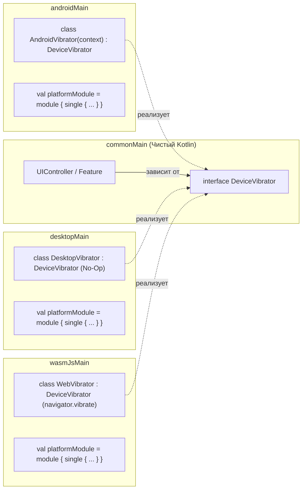

<div align="center">

<br />

# АРХИТЕКТУРНОЕ ПРАВИЛО: ИНТЕРФЕЙСЫ И DI ВМЕСТО EXPECT/ACTUAL

Строгий стандарт изоляции платформенных зависимостей в Kotlin Multiplatform проектах WHAT Technologies.

<br />


<br />
</div>

---

### Главный манифест

> **КАТЕГОРИЧЕСКИЙ ЗАПРЕТ:**  
> Механизм `expect / actual` **ЗАПРЕЩЕН** к использованию в бизнес-логике, фичах, контроллерах и UI-компонентах.

#### Почему `expect/actual` запрещен:
1. **Жесткая связность:** `expect/actual` создает скрытую монолитную связь между модулями, ломает инверсию зависимостей (DIP) и затрудняет модульное тестирование (Unit testing).
2. **Утечка деталей платформы:** Часто приводит к тому, что в `commonMain` протекают платформенные типы или ограничения.
3. **Проблемы с рефакторингом:** Изменение сигнатуры `expect` требует ручной синхронизации десятков файлов по всем таргетам (`androidMain`, `iosMain`, `jvmMain`, `wasmJsMain`).
4. **Невозможность мокирования:** `actual` нельзя легко подменить в тестах или создать фейковую реализацию (In-Memory Fake) без костылей.

---

### Золотой стандарт: Чистый интерфейс в commonMain + Koin DI

Любая функциональность, требующая обращения к возможностям конкретной ОС (файловая система, буфер обмена, шаринг, виброотклик, уведомления, криптография, хранилище), реализуется **исключительно** по следующему 4-шаговому шаблону:



---

### Эталонный пример реализации

#### Шаг 1. Объявление интерфейса в `commonMain`
Никаких импортов `android.*` или `java.*`. Только стандартные типы Kotlin:

```kotlin
// commonMain/kotlin/app/what/feature/domain/ClipboardProvider.kt
package app.what.feature.domain

interface ClipboardProvider {
    fun copyText(label: String, text: String)
    fun getText(): String?
}
```

#### Шаг 2. Реализация интерфейса в платформенных модулях

**В `androidMain`:**
```kotlin
// androidMain/kotlin/app/what/feature/platform/AndroidClipboardProvider.kt
package app.what.feature.platform

import android.content.ClipData
import android.content.ClipboardManager
import android.content.Context
import app.what.feature.domain.ClipboardProvider

class AndroidClipboardProvider(private val context: Context) : ClipboardProvider {
    private val clipboard = context.getSystemService(Context.CLIPBOARD_SERVICE) as ClipboardManager

    override fun copyText(label: String, text: String) {
        val clip = ClipData.newPlainText(label, text)
        clipboard.setPrimaryClip(clip)
    }

    override fun getText(): String? {
        return clipboard.primaryClip?.getItemAt(0)?.text?.toString()
    }
}
```

**В `desktopMain`:**
```kotlin
// desktopMain/kotlin/app/what/feature/platform/DesktopClipboardProvider.kt
package app.what.feature.platform

import app.what.feature.domain.ClipboardProvider
import java.awt.Toolkit
import java.awt.datatransfer.DataFlavor
import java.awt.datatransfer.StringSelection

class DesktopClipboardProvider : ClipboardProvider {
    override fun copyText(label: String, text: String) {
        val selection = StringSelection(text)
        Toolkit.getDefaultToolkit().systemClipboard.setContents(selection, selection)
    }

    override fun getText(): String? {
        val clipboard = Toolkit.getDefaultToolkit().systemClipboard
        return if (clipboard.isDataFlavorAvailable(DataFlavor.stringFlavor)) {
            clipboard.getData(DataFlavor.stringFlavor) as? String
        } else null
    }
}
```

**В `wasmJsMain`:**
```kotlin
// wasmJsMain/kotlin/app/what/feature/platform/WasmClipboardProvider.kt
package app.what.feature.platform

import app.what.feature.domain.ClipboardProvider
import kotlinx.browser.window

class WasmClipboardProvider : ClipboardProvider {
    override fun copyText(label: String, text: String) {
        window.navigator.clipboard.writeText(text)
    }

    override fun getText(): String? {
        return null // Чтение асинхронно в Web API
    }
}
```

#### Шаг 3. Регистрация в DI (Koin)

В каждом платформенном модуле объявляется модуль зависимостей `platformModule`:

* **`androidMain`:**
  ```kotlin
  val platformModule = module {
      single<ClipboardProvider> { AndroidClipboardProvider(androidContext()) }
  }
  ```
* **`desktopMain`:**
  ```kotlin
  val platformModule = module {
      single<ClipboardProvider> { DesktopClipboardProvider() }
  }
  ```
* **`wasmJsMain`:**
  ```kotlin
  val platformModule = module {
      single<ClipboardProvider> { WasmClipboardProvider() }
  }
  ```

#### Шаг 4. Внедрение и использование в общем коде (`commonMain`)

Контроллеры и Composable-функции в общем коде работают **исключительно** с интерфейсом:

```kotlin
// В MVI-контроллере:
class ShareController(
    private val clipboard: ClipboardProvider
) : UIController<ShareState, ShareAction, ShareEvent>(ShareState()) {

    override fun obtainEvent(viewEvent: ShareEvent) {
        when (viewEvent) {
            is ShareEvent.CopyLink -> {
                clipboard.copyText("Link", viewEvent.url)
                emitAction(ShareAction.Toast("Ссылка скопирована"))
            }
        }
    }
}
```

Или в Composable-функции через `koinInject()`:

```kotlin
@Composable
fun CopyButton(text: String, clipboard: ClipboardProvider = koinInject()) {
    Button(onClick = { clipboard.copyText("Text", text) }) {
        Text("Копировать")
    }
}
```

---

### Сводные правила для AI и разработчиков

| Требование | Правильно | Запрещено |
| :--- | :--- | :--- |
| **Интерфейс** | `interface PlatformStorage` в `commonMain` | `expect class PlatformStorage` |
| **Реализация** | `class AndroidStorage : PlatformStorage` в `androidMain` | `actual class PlatformStorage` |
| **Доступ к платформе** | Инъекция через `Koin` (`inject()` / `koinInject()`) | Прямой вызов платформенного `expect/actual` |
| **Тестирование** | `class FakeStorage : PlatformStorage` (любой тест без моков ОС) | Невозможно подменить без перекомпиляции |

<br />

<div align="center">
<sub>© WHAT Technologies. Архитектурный стандарт экосистемы.</sub>
</div>
